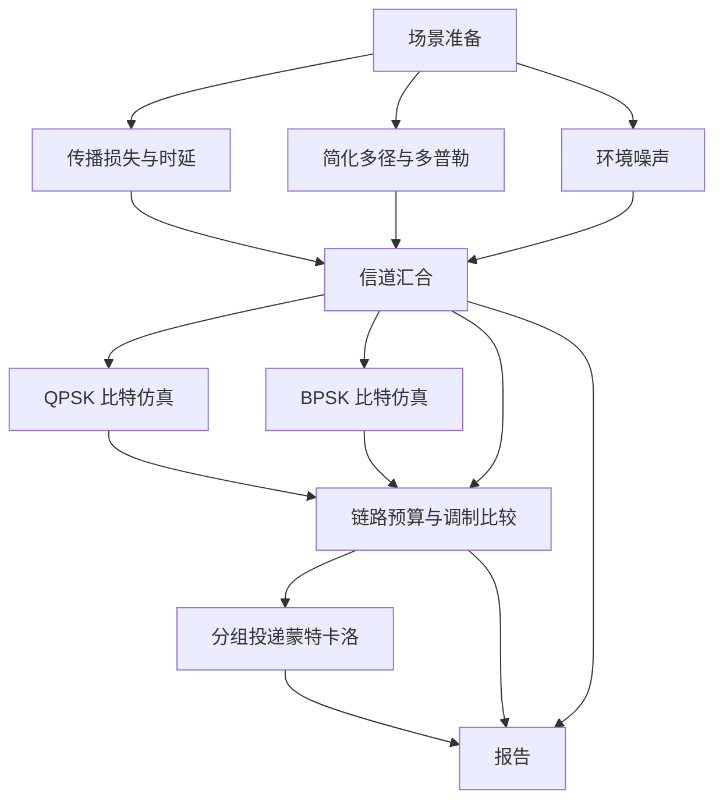

# 水下通信链路仿真 MCP 演示

本目录提供可运行的本机完整演示：Agent 调用真实 MCP，模板脚本负责查询资源、动态申请配额、执行仿真 DAG、回收资源和生成报告。数值计算在独立 Node 子进程中执行，进度来自后台事件，不由浏览器或语言模型填写。

资源池是单个 MCP 服务实例内的演示配额账本，不是 Slurm/Kubernetes，也不提供 CPU/内存硬隔离。信道与链路采用简化模型，用于演示交互、流程和执行约束，不作为工程设计或海试预测结论。

## 1. 先运行

在 dsh-demo 根目录执行：

```bash
npm ci
npm run web -- --offline
```

打开日志中的本机地址，在聊天框输入：

```text
/sim-resources
/simulate small
```

第二条会持续输出真实任务状态。右侧“仿真任务”标签显示集群配额、任务列表、阶段和节点进度、依赖、串行锁、完整事件与结果。可以取消任务，也可以下载完整任务 JSON。

支持的离线命令：

| 命令 | 行为 |
| --- | --- |
| `/sim-resources` | 经 MCP 查询当前配额和本机资源观测。 |
| `/simulate small` | 小规模完整链路仿真，并自动查询状态直到终态。 |
| `/simulate medium` / `/simulate large` | 更大配额及更多真实比特、分组样本。 |
| `/simulate small {"distanceM":2000,"carrierKhz":10,"seed":87}` | 用显式 JSON 覆盖场景默认值。 |
| `/sim-status 任务UUID` | 查看指定任务；同一聊天已有任务时可省略 UUID。 |
| `/sim-cancel 任务UUID` | 取消指定任务并等待资源回收；同一聊天可省略 UUID。 |

离线模型只识别这些固定命令。真实模型模式可说“先查看集群资源，再运行一个 2 千米、12 kHz 的中等规模水下链路仿真，持续查看状态并总结结果”；工具描述会引导模型调用相同模板流程。模型是否遵循意图取决于其能力，但后台始终强制资源、依赖和串行约束。

任务独立于聊天轮次。停止生成、新对话或关闭网页不会自动取消后台任务；需要显式取消。停用 MCP 插件或正常停止整个服务，会先取消该服务拥有的活动任务，再关闭子进程和回收资源。历史快照保存在 `.dsh/simulations/`，重启后可以查看，活动任务不会自动恢复执行。

## 2. 模板如何约束执行

高层流程固定在 `templates/underwater-link.json` 的 procedure：

```text
plan → inspect → reserve → submit
规划   查资源     申请配额    后台提交
```

每次申请需要计划 ID 和有效的资源查询 snapshotId。资源快照过期、账本版本已变化、配额不足或计划已经用过时，后台拒绝申请。提交需要与计划匹配、尚未使用且未过期的租约；不能跳过申请直接启动节点。

模板中的计算依赖如下。箭头表示必须等待上游成功；传播与多径还共享同一把串行锁：



三种约束在真正启动子进程之前同时检查：

| 字段/规则 | 作用 | 当前示例 |
| --- | --- | --- |
| `group` | 节点归属的父阶段，用于展示层级。执行约束由 dependsOn 明确声明。 | scenario、channel、communication、link。 |
| `dependsOn` | 所有指定父节点必须 completed，后继才能执行。 | 通信必须等待信道汇合；链路必须等待两个通信分支。 |
| `serialGroup` | 同一服务的所有任务共享互斥锁。组名相同的计算不可同时运行。 | propagation 与 multipath 共用 acoustic-solver。 |
| `resources` | 节点占用不能超过本任务租约的剩余 CPU/内存。 | small 的两个通信节点各需 2 CPU，可同时运行。 |
| `maxParallel` | 任务内最大并发子进程数。 | small=3，medium/large=4。 |

因此 propagation 可以与 noise 并行，但不能与 multipath 同时运行；QPSK 和 BPSK 在信道汇合后可并行；链路预算、分组统计和报告按依赖串行推进。不同任务也不能同时占用 acoustic-solver，但没有串行锁冲突的节点可以在各自已申请资源内并行。

节点失败时，任务失败、终止活动同伴、跳过未执行后继。取消时终止活动计算并标记未执行节点为 cancelled。两种情况都必须等子进程 close 后才回收租约，不会先释放资源再放任计算继续运行。

## 3. 动态资源与规模

`templates/cluster.json` 定义演示集群总量为 16 CPU / 32 GB。`cluster_resources` 同时返回本机可用 CPU 数量和内存观测；两组数值分开标记，模板容量不等同于真实物理空闲量。

| 规模 | 任务租约 CPU / 内存 | 最大并发 | 每种调制检测比特数 | 分组试验数 |
| --- | --- | --- | --- | --- |
| small | 4 / 8 GB | 3 | 12,000 | 2,000 |
| medium | 8 / 16 GB | 4 | 60,000 | 10,000 |
| large | 12 / 24 GB | 4 | 180,000 | 30,000 |

规模还会相应放大节点的逻辑资源需求。申请的是完整任务租约，节点完成后归还任务内可用额度，任务终态再归还集群额度。剩余资源不够时会明确拒绝；当前版本没有排队等待和自动重试申请。

资源查询快照与闲置租约默认有效期都是 30 秒，在后续账本操作时检查到期。运行中的租约不按闲置 TTL 回收。一个租约只能绑定一个任务；释放正在运行的租约会被拒绝，应先取消任务。

## 4. MCP 工具

下面是服务原始工具名；Agent 看到的公开名带 `mcp__demo__` 前缀，例如 `mcp__demo__run_simulation`。

| 工具 | 输入要点 | 返回与用途 |
| --- | --- | --- |
| `simulation_templates` | 无 | 版本、阶段、节点、依赖、串行组、默认参数与规模策略。 |
| `cluster_resources` | 无 | 有时效的 snapshotId、容量、占用、可用额度和本机观测。 |
| `simulation_plan` | scale、target、parameters | 不可变计划 ID、所需配额和展开后的 DAG。 |
| `request_resources` | planId、snapshotId | 专属 lease ID，或资源/快照错误。 |
| `release_resources` | leaseId | 归还尚未提交的资源。 |
| `submit_simulation` | planId、leaseId | 立即返回异步任务及 job ID。 |
| `run_simulation` | scale、target、parameters | 按 procedure 自动规划、查资源、申请、提交。默认 target=link。 |
| `simulate_channel` | scale、parameters | 只运行信道目标及所需场景前置。 |
| `simulate_communication` | scale、parameters | 运行通信目标，自动包含同参数的信道前置。 |
| `simulate_link` | scale、parameters | 运行完整链路，包括所有前置和报告。 |
| `simulation_status` | jobId、可选 afterSeq/waitMs | 实时快照、节点状态、结果及新增事件；waitMs 最大 2000。 |
| `list_simulations` | 无 | 所有当前服务可见任务的摘要，包括恢复的历史。 |
| `cancel_simulation` | jobId | 等待取消与资源回收后返回最终状态。 |

`target` 可选 channel、communication、link。单独调用通信或链路工具不会跳过上游：模板会求目标的依赖闭包并在同一任务里执行。当前不跨任务复用中间结果，以免混用不同场景、版本和种子的输出。连续跑完整链路优先调用一次 `run_simulation` 或 `simulate_link`。

状态是 queued → running → completed/failed/cancelled；取消过程中会短暂出现 cancelling。事件 seq 连续递增，资源查询、申请、释放、节点开始、进度和终态都有记录。Agent 使用 afterSeq 只取新事件，Web 查看和下载保留全部事件。

## 5. 模板化脚本与每个文件

| 文件 | 作用 |
| --- | --- |
| `templates/cluster.json` | 配额容量、快照/租约 TTL、规模到资源与样本量的映射。 |
| `templates/underwater-link.json` | 流程 procedure、参数默认值、阶段、目标节点、DAG、每节点资源与串行锁。 |
| `templates/run-node.mjs.tpl` | 节点可执行脚本模板；TASK_JSON 和 WORKER_URL_JSON 使用 JSON 字面量替换。 |
| `resources.mjs` | 集群账本、快照、动态租约、绑定与释放的实际强制逻辑。 |
| `workflow.mjs` | 规划、模板校验、依赖闭包、生成脚本、资源感知调度、全局串行锁、状态持久化和收尾。 |
| `kernels.mjs` | 简化信道、通信比特与链路分组数值内核，支持固定种子复现。 |
| `mcp.mjs` | MCP 工具 schema、描述及协议适配；本身不复制调度逻辑。 |
| `workflow.spec.mjs` | 真子进程验证资源边界、串并行、故障、取消、脚本生成和历史恢复。 |
| `../scripts/simulation-node.mjs` | 通用节点执行脚本：stdin JSON 输入，stdout JSON Lines 进度与结果。 |
| `../scripts/simulation-workflow.mjs` | 无 Agent 的脚本入口，复用相同模板流程，输出增量事件。 |
| `../scripts/simulation-smoke.mjs` | 官方 MCP 协议及真实 Agent/Web 的端到端验证。 |
| `../src/offline-simulation.ts` | 离线固定命令规则，只发 MCP 调用和读取结果。 |
| `../src/simulation-monitor.ts` | Web 状态/资源/取消接口，始终调用同一 MCP 工具。 |
| `../web/simulation.js` | 一秒刷新任务状态、展示阶段和节点、取消与 JSON 下载。 |

执行时会实例化真正的脚本，例如：

```text
.dsh/simulations/<jobId>/
├── job.json                      完整任务快照与全部事件
├── scripts/
│   ├── scenario.mjs              从 run-node.mjs.tpl 实例化
│   ├── propagation.mjs
│   ├── comm-qpsk.mjs
│   └── ...
├── scenario.json                 成功节点的数值输出
├── channel-summary.json
├── comm-qpsk.json
├── comm-bpsk.json
├── link-monte-carlo.json
└── report.json                   完整链路报告
```

任务参数以 JSON stdin 传入，子进程使用参数数组启动，不把模型输入拼成 shell 命令。模板必须引用项目内文件和已注册任务；DAG 环、未知任务、无法容纳单个节点的资源配置会在提交前被拒绝。

不用 Agent 也能复现相同流程：

```bash
# 完整小规模链路任务。
npm run simulation -- small
# 只运行中等规模信道及其必要前置。
npm run simulation -- medium channel
# 通信与链路还可使用 communication、link 目标。
npm run simulation -- small communication
```

## 6. 数值模型的含义

- 传播：采用 1.5 扩展系数与 Thorp 吸收近似，计算标量损失和距离/声速传播时延。参考 [ns-3 UAN Thorp 模型](https://www.nsnam.org/doxygen/d9/d91/classns3_1_1_uan_prop_model_thorp.html)。
- 多径：按距离和深度构造三条示意路径，固定相对功率，计算 RMS 时延扩展和简化多普勒；不是 Bellhop、抛物方程或实测海况求解。
- 噪声：平坦谱密度加上带宽积分，参数单位写在模板和 MCP schema 中。
- 通信：根据标量 SNR、比特率及启发式 ISI 惩罚计算有效 Eb/N0，生成随机比特和高斯噪声，实际做阈值检测统计错误。QPSK 使用 Gray 映射等效的 I/Q 二进制支路；理想 AWGN 比特检测基准见 [MathWorks 相位调制说明](https://www.mathworks.com/help/comm/ug/phase-modulation.html)。没有执行完整采样波形卷积、均衡或纠错编码。
- 链路：按独立误码假设估计分组成功概率，再用固定种子的蒙特卡洛统计投递率和有效吞吐。时延只含传播与发送时间，不含排队、MAC 竞争或重传。

相同模板、参数和 seed 会产生相同数值结果。有限样本零误码不代表真实 BER=0，高信噪比下应增加样本量。默认每节点有 1200ms 的 demoPacingMs，便于看清执行状态；它是明确的展示等待，不是求解器耗时或实时海洋仿真时间。测试可在运行器构造时减小该节奏。

## 7. 替换为真实后台的位置

先修改模板中的资源容量、规模策略、节点和依赖；保留明确的单位与范围。然后在 resources.mjs 的 inspect/reserve/bind/release 对接实际集群 API，在节点脚本模板/worker 位置接入真实信道、通信和链路程序，继续输出相同进度协议。语言模型、MCP 工具名与网页无需承担节点排序。

当前配额和全局锁只在一个 MCP 服务实例内共享。同时启动两个独立 demo 进程会有各自账本；真正的多节点集群需集中式调度、持久租约和身份权限。当前版本不自动重试失败节点、不跨任务缓存结果，也不在异常进程崩溃后恢复执行。

## 8. 验证

```bash
npm run simulation:test
npm run simulation:smoke
# 在无相邻仓库的新副本里重新安装、构建和验证全部功能。
npm run standalone:smoke
```

第一组检查真实子进程的时间区间和事件顺序，证明前置完成、串行互斥、并行重叠和资源上限，并验证出错/取消后子进程退出。第二组经过真实 MCP stdio、官方 CLI、AgentLoop 与 HTTP/SSE，验证 Agent 持续读取状态、Web 监控同一任务、数值报告和取消回收。所有验证都使用离线模型，不调用收费外部 API。
