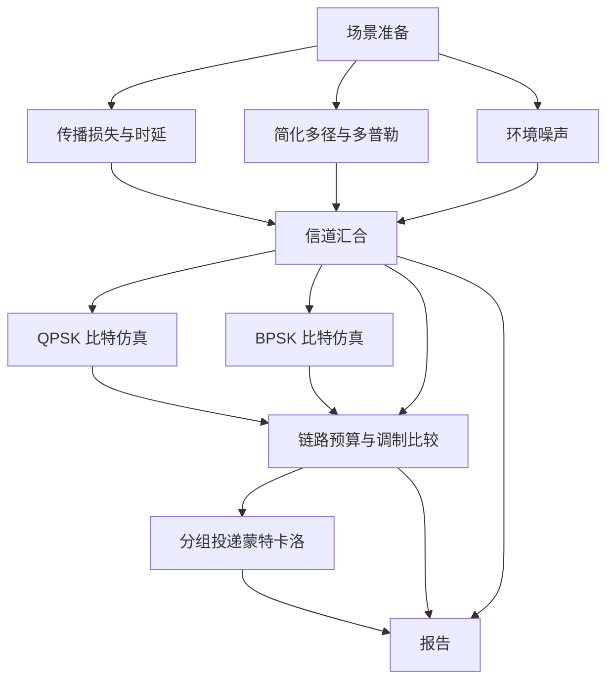

# 水下通信链路本地模板仿真

Agent 的工具接入见[五平台 HTTP Mock 与 MCP 接入](platform-mock/README.md)。

本目录的本地模板演示查询资源、申请配额、执行仿真 DAG 并生成报告。数值计算在独立 Node 子进程中执行。资源池是进程内配额账本，信道和链路采用简化模型。

## 1. 先运行

```bash
npm run simulation -- small
```

命令持续输出 JSON Lines 任务事件和终态。可按 Ctrl+C 取消任务并回收配额。任务快照保存在 `.dsh/simulations/`。

## 2. 模板如何约束执行

高层流程固定在 `templates/underwater-link.json` 的 procedure：

```text
plan → inspect → reserve → submit
规划   查资源     申请配额    后台提交
```

每次申请需要计划 ID 和有效的资源查询 snapshotId。资源快照过期、账本版本已变化、配额不足或计划已经用过时，后台拒绝申请。提交需要与计划匹配、尚未使用且未过期的租约；不能跳过申请直接启动节点。

模板中的计算依赖如下。箭头表示必须等待上游成功；传播与多径还共享同一把串行锁：



三种约束在真正启动子进程之前同时检查：

| 字段/规则 | 作用 | 当前示例 |
| --- | --- | --- |
| `group` | 节点归属的父阶段，用于展示层级。执行约束由 dependsOn 明确声明。 | scenario、channel、communication、link。 |
| `dependsOn` | 所有指定父节点必须 completed，后继才能执行。 | 通信必须等待信道汇合；链路必须等待两个通信分支。 |
| `serialGroup` | 同一服务的所有任务共享互斥锁。组名相同的计算不可同时运行。 | propagation 与 multipath 共用 acoustic-solver。 |
| `resources` | 节点占用不能超过本任务租约的剩余 CPU/内存。 | small 的两个通信节点各需 2 CPU，可同时运行。 |
| `maxParallel` | 任务内最大并发子进程数。 | small=3，medium/large=4。 |

因此 propagation 可以与 noise 并行，但不能与 multipath 同时运行；QPSK 和 BPSK 在信道汇合后可并行；链路预算、分组统计和报告按依赖串行推进。不同任务也不能同时占用 acoustic-solver，但没有串行锁冲突的节点可以在各自已申请资源内并行。

节点失败时，任务失败、终止活动同伴、跳过未执行后继。取消时终止活动计算并标记未执行节点为 cancelled。两种情况都必须等子进程 close 后才回收租约，不会先释放资源再放任计算继续运行。

## 3. 动态资源与规模

`templates/cluster.json` 定义演示集群总量为 16 CPU / 32 GB。`cluster_resources` 同时返回本机可用 CPU 数量和内存观测；两组数值分开标记，模板容量不等同于真实物理空闲量。

| 规模 | 任务租约 CPU / 内存 | 最大并发 | 每种调制检测比特数 | 分组试验数 |
| --- | --- | --- | --- | --- |
| small | 4 / 8 GB | 3 | 12,000 | 2,000 |
| medium | 8 / 16 GB | 4 | 60,000 | 10,000 |
| large | 12 / 24 GB | 4 | 180,000 | 30,000 |

规模还会相应放大节点的逻辑资源需求。申请的是完整任务租约，节点完成后归还任务内可用额度，任务终态再归还集群额度。剩余资源不够时会明确拒绝；当前版本没有排队等待和自动重试申请。

资源查询快照与闲置租约默认有效期都是 30 秒，在后续账本操作时检查到期。运行中的租约不按闲置 TTL 回收。一个租约只能绑定一个任务；释放正在运行的租约会被拒绝，应先取消任务。

## 4. 目标与任务状态

`target` 可选 `channel`、`communication`、`link`。运行指定目标时，模板在同一任务中执行所需的上游节点。任务状态为 queued → running → completed/failed/cancelled。取消期间可能短暂出现 cancelling。资源申请和释放、节点进度以及终态均写入连续编号的事件。

## 5. 模板化脚本与每个文件

| 文件 | 作用 |
| --- | --- |
| `templates/cluster.json` | 配额容量、快照/租约 TTL、规模到资源与样本量的映射。 |
| `templates/underwater-link.json` | 流程 procedure、参数默认值、阶段、目标节点、DAG、每节点资源与串行锁。 |
| `templates/run-node.mjs.tpl` | 节点可执行脚本模板；TASK_JSON 和 WORKER_URL_JSON 使用 JSON 字面量替换。 |
| `resources.mjs` | 集群账本、快照、动态租约、绑定与释放的实际强制逻辑。 |
| `workflow.mjs` | 规划、模板校验、依赖闭包、生成脚本、资源感知调度、全局串行锁、状态持久化和收尾。 |
| `kernels.mjs` | 简化信道、通信比特与链路分组数值内核，支持固定种子复现。 |
| `workflow.spec.mjs` | 真子进程验证资源边界、串并行、故障、取消、脚本生成和历史恢复。 |
| `../scripts/simulation-node.mjs` | 通用节点执行脚本：stdin JSON 输入，stdout JSON Lines 进度与结果。 |
| `../scripts/simulation-workflow.mjs` | 无 Agent 的脚本入口，复用相同模板流程，输出增量事件。 |

执行时会实例化真正的脚本，例如：

```text
.dsh/simulations/<jobId>/
├── job.json                      完整任务快照与全部事件
├── scripts/
│   ├── scenario.mjs              从 run-node.mjs.tpl 实例化
│   ├── propagation.mjs
│   ├── comm-qpsk.mjs
│   └── ...
├── scenario.json                 成功节点的数值输出
├── channel-summary.json
├── comm-qpsk.json
├── comm-bpsk.json
├── link-monte-carlo.json
└── report.json                   完整链路报告
```

任务参数以 JSON stdin 传入，子进程使用参数数组启动，不把模型输入拼成 shell 命令。模板必须引用项目内文件和已注册任务；DAG 环、未知任务、无法容纳单个节点的资源配置会在提交前被拒绝。

可按规模和目标运行：

```bash
# 完整小规模链路任务。
npm run simulation -- small
# 只运行中等规模信道及其必要前置。
npm run simulation -- medium channel
# 通信与链路还可使用 communication、link 目标。
npm run simulation -- small communication
```

## 6. 数值模型的含义

- 传播：采用 1.5 扩展系数与 Thorp 吸收近似，计算标量损失和距离/声速传播时延。参考 [ns-3 UAN Thorp 模型](https://www.nsnam.org/doxygen/d9/d91/classns3_1_1_uan_prop_model_thorp.html)。
- 多径：按距离和深度构造三条示意路径，固定相对功率，计算 RMS 时延扩展和简化多普勒；不是 Bellhop、抛物方程或实测海况求解。
- 噪声：平坦谱密度加上带宽积分，参数单位写在模板 中。
- 通信：根据标量 SNR、比特率及启发式 ISI 惩罚计算有效 Eb/N0，生成随机比特和高斯噪声，实际做阈值检测统计错误。QPSK 使用 Gray 映射等效的 I/Q 二进制支路；理想 AWGN 比特检测基准见 [MathWorks 相位调制说明](https://www.mathworks.com/help/comm/ug/phase-modulation.html)。没有执行完整采样波形卷积、均衡或纠错编码。
- 链路：按独立误码假设估计分组成功概率，再用固定种子的蒙特卡洛统计投递率和有效吞吐。时延只含传播与发送时间，不含排队、MAC 竞争或重传。

相同模板、参数和 seed 会产生相同数值结果。有限样本零误码不代表真实 BER=0，高信噪比下应增加样本量。默认每节点有 1200ms 的 demoPacingMs，便于看清执行状态；它是明确的展示等待，不是求解器耗时或实时海洋仿真时间。测试可在运行器构造时减小该节奏。

## 7. 替换为真实后台的位置

先修改模板中的资源容量、规模策略、节点和依赖；保留明确的单位与范围。然后在 resources.mjs 的 inspect/reserve/bind/release 对接实际集群 API，在节点脚本模板/worker 位置接入真实信道、通信和链路程序，继续输出相同进度协议。节点排序由模板负责。

当前配额和全局锁只在一个模板运行进程内共享。同时启动两个独立 demo 进程会有各自账本；真正的多节点集群需集中式调度、持久租约和身份权限。当前版本不自动重试失败节点、不跨任务缓存结果，也不在异常进程崩溃后恢复执行。

## 8. 验证

```bash
npm run simulation:test
# 在无相邻仓库的新副本里重新安装、构建和验证全部功能。
npm run standalone:smoke
```

模板测试检查真实子进程的时间区间和事件顺序，验证前置依赖、串行互斥、并行重叠和资源上限，并验证失败和取消后子进程退出。独立安装验证还覆盖五平台 MCP 接入。
